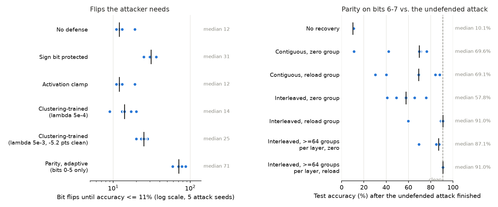

# 비트 플립 방어 벤치마크

[README](README.md)의 실험에서 표적 비트 플립 15개로 int8 ResNet-20의 정확도가 10%까지 떨어졌다. 이 문서는 그 결과 끝에 적어 둔 방어 아이디어들을 실제로 측정한 결과다. 기준은 **공격자가 정확도를 11% 이하로 떨어뜨리려면 비트를 몇 개 뒤집어야 하는가**이고, 숫자가 클수록 좋은 방어다.



## 요약

| 방어 | 원래 정확도 | 필요한 플립 수 (seed 5개) | 중앙값 | 방어 없음 대비 |
|---|---:|---|---:|---:|
| 없음 | 90.98% | 11, 12, 12, 13, 19 | 12 | 1× |
| 부호 비트 보호 | 90.98% | 25, 30, 31, 36, 36 | 31 | 2.6× |
| 활성값 clamp | 90.98% | 11, 12, 12, 13, 19 | 12 | 1× |
| clustering 학습 (λ=5e-4) | 90.66% | 9, 13, 14, 17, 20 | 14 | 1.2× |
| clustering 학습 (λ=5e-3) | **85.80%** | 20, 23, 25, 26, 28 | 25 | 2.1× |
| 그룹 패리티, 이를 아는 공격자 | 90.98% | 59, 70, 71, 78, 87 | 71 | 5.9× |

- 활성값 clamp는 효과가 없었다. 다섯 번 모두 공격이 고른 플립까지 방어 없음과 같았다.
- clustering 학습은 정확도를 5%p 내줘야 2배 정도 효과가 났다.
- 부호 비트만 보호해도 2.6배가 됐다. 그러자 공격자는 bit 6으로 옮겨 갔다(158개 중 156개).
- 패리티는 패리티를 모르는 공격자의 플립을 탐지·복구하는 데에는 좋았다. 다만 그룹을 나누는 방식에 따라 결과가 크게 달랐다(아래).
- 패리티를 아는 공격자는 패리티가 지키지 않는 bit 0~5만 써서 71개 정도로 모델을 무너뜨렸다.
- 이 표의 어떤 방어도 공격을 막지는 못했고, 필요한 비트 수를 늘렸을 뿐이다.

## 공격

[README](README.md)의 `attack.py`는 1차 근사 점수만으로 비트를 골랐다. 여기서는 원 논문(Rakin et al., ICCV 2019)의 Progressive Bit Search에 더 가깝게 바꿨다.

- 한 단계마다 공격 배치의 그래디언트를 구한다. 층마다 모든 (가중치, 비트) 쌍의 1차 근사 점수를 계산해 상위 5개를 고른다.
- 22개 층에서 나온 후보 110개를 **하나씩 실제로 뒤집어** 공격 배치 손실을 재고 되돌린다. 손실을 가장 많이 올린 하나를 확정한다.
- 정확도가 11% 이하가 되거나 300단계가 될 때까지 반복한다.
- 공격 배치 128장은 seed마다 테스트 이미지 5,000~9,999번에서 새로 뽑았다. 정확도는 0~4,999번으로 쟀으므로 두 집합은 겹치지 않는다.
- 이전 `attack.py`는 다른 공격 배치(테스트 이미지 9,000번부터 128장)로 15개가 필요했다. 이 공격은 seed 5개에서 11~19개(중앙값 12)였다. 공격 배치가 달라서 두 방식의 강도를 직접 비교할 수는 없다.
- 방어를 아는 공격자(적응형)는 공격자가 고를 수 있는 비트를 제한하는 방식으로 표현했다. 부호 비트 보호는 bit 0~6, 패리티는 bit 0~5다. clamp는 순전파에 들어 있으므로 그래디언트가 이미 clamp를 반영한다.

## 방어별 결과

### 부호 비트 보호

- **가정**: 부호 비트(bit 7)를 ECC나 복제본으로 따로 지켜서 공격자가 뒤집을 수 없다.
- **결과**: 중앙값 12개에서 31개로 늘었다. 공격자는 bit 6으로 옮겨 갔다. bit 6을 뒤집으면 값이 ±64 바뀌므로 bit 7(±128)의 절반 정도 효과를 낸다.
- **비용**: 부호 비트를 세 벌 저장하면 가중치 메모리가 25% 늘어난다. 단일 패리티로 탐지만 한다면 훨씬 적다.

### 활성값 clamp

- **방법**: 학습 이미지 50,000장에서 stem 출력과 9개 블록 출력의 채널별 최댓값을 기록한다. 추론할 때 그 값을 넘는 활성값을 잘라낸다.
- **결과**: 효과가 없었다. 다섯 seed 모두 공격이 고른 플립이 방어 없음과 같았고, 필요한 플립 수도 같았다.
- **원인 확인**: stem conv의 가중치 하나를 뒤집은 상태에서 10개 지점의 활성값을 확인했다. 경계를 넘은 값은 하나도 없었다(0.00000).
- **해석**: 채널별 최댓값은 학습 데이터 중 가장 극단적인 이미지가 정한다. 그래서 공격이 만드는 변화보다 경계가 넉넉하다. 처음 예상한 "특정 채널의 폭주"도 경계를 넘을 만큼 크지 않았다. 더 좁은 경계(예: 99.9 백분위)를 쓰면 결과가 달라질 수 있지만 측정하지 않았다.

### clustering 학습

- **방법**: He et al.(CVPR 2020)의 piece-wise clustering 항을 학습 손실에 더했다. 층마다 양수 가중치는 양수 평균 쪽으로, 음수 가중치는 음수 평균 쪽으로 모은다(`train.py --cluster`).
- **λ=5e-4**:
  - 정확도는 90.66%였다.
  - 양수 가중치의 상대 분산(std/mean, 층별 중앙값)은 0.81에서 0.52로 줄었다.
  - 하지만 필요한 플립은 중앙값 14개로 거의 변하지 않았다.
- **λ=5e-3**:
  - 상대 분산은 0.21까지 줄었다.
  - 필요한 플립은 25개로 늘었다.
  - 대신 정확도가 85.80%로 떨어졌다. 학습 로그 기준 10,000장 정확도는 86.16%다.
- **해석**: 가중치가 두 값 근처로 모이면 층의 최댓값(곧 양자화 scale) 대비 평균 크기가 커진다(0.18에서 0.50). 그러면 bit 7을 뒤집어 생기는 ±128의 상대적 영향이 작아지는 것으로 보인다. 같은 epoch 수(40)로 학습했기 때문에, 정확도 손실은 학습을 더 길게 하면 줄어들 수 있다.

### 그룹 패리티

- **방법**: 가중치 64개를 한 그룹으로 묶고, 그룹마다 bit 7 패리티와 bit 6 패리티를 1비트씩 저장한다. 그룹 패리티가 바뀌면 그 그룹을 복구한다.
  - 복구 방식 두 가지:
    - **zero**: 그룹을 0으로 지운다. 추가 저장소가 필요 없다.
    - **reload**: 그룹만 깨끗한 사본에서 다시 읽는다. 플래시 등에 원본이 있다고 가정한다.
  - 그룹 나누는 방식 세 가지:
    - **contiguous**: 메모리 순서대로 64개씩 묶는다.
    - **interleaved**: 층마다 비밀 순열로 섞은 뒤 64개씩 묶는다.
    - **interleaved, 그룹 최소 64개**: 작은 층은 그룹 크기를 줄여 층마다 그룹이 64개 이상 되게 한다.
- **평가**: 패리티를 모르는 공격자(방어 없음과 같은 탐색)가 정확도를 11% 이하로 떨어뜨린 직후의 메모리 상태에서 측정했다. 공격자가 패리티를 무시하므로 플립은 그룹 방식과 상관없다. 그래서 기록된 플립을 다시 적용하는 방식(`defense.py replay`)으로 세 방식을 같은 플립 위에서 비교했다.

| 그룹 방식 | 패리티 비트 | zero 복구 정확도 | reload 복구 정확도 |
|---|---:|---|---|
| contiguous | 8,466 | 11.0, 42.2, 69.6, 71.0, 76.5 | 30.3, 40.0, 69.1, 84.3, 88.0 |
| interleaved | 8,466 | 41.0, 49.2, 57.8, 65.6, 75.9 | 59.9, 89.1, 91.0, 91.0, 91.0 |
| interleaved, 그룹 최소 64개 | 9,216 | 69.4, 85.1, 87.1, 87.3, 87.7 | **91.0 ×5** |

**contiguous가 뚫린 이유.**
- 공격은 한 층의 한 출력 채널에 몰린다. 예를 들어 `layers.1.c1`의 같은 그룹에 bit 7 플립이 6개 몰린 seed도 있었다.
- conv 가중치는 `[출력, 입력, k, k]` 순서로 저장된다. 그래서 같은 채널의 가중치는 메모리에서 이웃한다.
- 같은 그룹에 같은 비트 플립이 짝수 개 들어가면 패리티가 원래대로 돌아와 탐지되지 않는다. 다섯 seed 모두에서 이런 그룹이 1~3개 있었다.

**interleaved도 두 seed에서 뚫린 이유.**
- 이번에는 공격이 `fc`(가중치 640개, 10그룹)나 `layers.3.sc.0`(512개, 8그룹) 같은 작은 층에 몰렸다.
- 그룹이 10개뿐인 층에 플립 8개가 들어가면, 섞어도 두 개가 같은 그룹에 들어갈 확률이 높다.
- seed 2에서는 `fc`의 3개 그룹을 포함해 5개 그룹이 짝수 플립으로 숨었다.

**zero 복구가 나쁜 이유.**
- 그룹을 0으로 지우면 공격받지 않은 가중치 63개도 함께 사라진다.
- 첫 conv(432개, 7그룹)나 fc처럼 작은 층에서는 층의 상당 부분이 지워진다.
- 그래서 탐지가 완벽해도 정확도가 크게 떨어진다(interleaved zero, 중앙값 57.8%).
- 작은 층의 그룹을 줄이면 지워지는 양도 줄어 중앙값 87.1%가 됐다.

**개선안.**
- 작은 층의 그룹을 잘게 나누면 다섯 seed 모두 탐지와 복구에 성공했다.
- 비용은 패리티 비트 9,216개로, 가중치 비트(2,167,168개)의 0.43%다.

**적응형 공격자.**
- 패리티가 bit 6~7만 지킨다는 것을 아는 공격자는 bit 0~5만 쓴다(bit 5가 349개, bit 4가 16개).
- 이 공격자는 탐지에 한 번도 걸리지 않고 59~87개로 모델을 무너뜨린다.
- 모든 비트 평면에 패리티를 두면 이 경로도 막을 수 있지만, 비용이 4배가 된다. 이 구성은 측정하지 않았다.

### 비교용: 전체 CRC32

- int8 가중치 전체(270,896 바이트)의 CRC32 계산은 한 번에 **18 µs**였다. CPU에서 Python `zlib.crc32`로, 100회 평균을 냈다.
- 같은 GPU에서 이미지 1,000장을 추론하는 데 33.7 ms가 걸리므로 비교가 안 될 만큼 작다.
- 깨끗한 사본이 있다면 "추론마다 CRC 확인, 틀리면 전체 재로드"가 위의 어떤 방법보다 단순하고 확실하다. 모든 비트 평면을 다 잡기 때문이다.
- 그룹 패리티가 의미 있는 경우는 둘이다.
  - 전체를 다시 읽기 어려울 만큼 모델이 클 때: 어디가 바뀌었는지 알려준다.
  - 사본 없이 zero 복구로 버텨야 할 때.

## 한계

- **seed가 5개뿐이다.** 중앙값 사이의 차이(예: 12와 14)는 seed 간 편차(11~19)보다 작으므로 의미 있는 차이로 볼 수 없다.
- **시뮬레이션이다.** 실제 Rowhammer는 원하는 비트를 마음대로 고를 수 없다. 이 숫자들은 "고를 수 있다면"의 상한 비교다.
- **적응형 공격을 단순하게 모델링했다.** 고를 수 있는 비트만 제한했다. 패리티를 아는 공격자가 bit 7 플립을 짝수 개로 맞춰 상쇄시키는 공격은 구현하지 않았다. contiguous 그룹에서는 공격자가 노리지 않았는데도 이런 상쇄가 일어났으므로, 노리면 더 쉬울 것이다.
- **패리티 결과는 공격이 끝난 시점에서 한 번만 쟀다.** 추론 중간중간 검사해서 플립이 쌓이기 전에 복구하는 시나리오는 측정하지 않았다.
- **clustering 하이퍼파라미터를 두 개만 시도했다.** λ와 학습 길이를 더 조정하면 정확도 손실과 방어 효과의 균형이 달라질 수 있다.
- **clamp는 채널별 최댓값 하나만 시도했다.**

## 재현

```bash
python train.py --cluster 5e-4                              # resnet20_pc.pt (약 16분)
python train.py --cluster 5e-3 --out resnet20_pc5e-3.pt     # (약 11분)
python defense.py run base sign clamp pc pc-strong parity-adapt   # 약 10분
python defense.py replay                                    # 패리티 그룹 방식 비교
python defense.py plot                                      # defense.png
```

| 파일 | 내용 |
|---|---|
| `defense.py` | 공격(PBS), 방어 설정, 패리티, replay |
| `defense_plot.py` | `defense_results.json`만으로 그래프 그리기 |
| `defense_results.json` | 설정·seed별 정확도 곡선, 뒤집은 비트 전체, 패리티 복구 결과, 오버헤드 |
| `defense_log.txt`, `defense_pc_log.txt`, `defense_pcstrong_log.txt` | 실행 로그 |
| `train_pc_log.txt`, `train_pc5e-3_log.txt` | clustering 학습 로그 |
