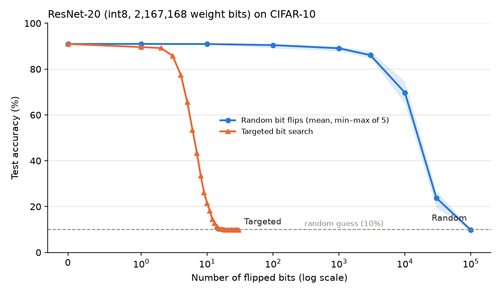

# int8 ResNet-20 비트 플립 공격 실험

> 방어 실험 결과는 [DEFENSE.md](DEFENSE.md)에 있다.

CIFAR-10으로 학습한 ResNet-20의 가중치를 int8로 양자화한 뒤, 메모리의 가중치 비트를 **무작위로** 뒤집을 때와 **골라서** 뒤집을 때 정확도가 얼마나 떨어지는지 비교했다. 골라서 뒤집는 방식은 Rakin et al., *Bit-Flip Attack: Crushing Neural Network with Progressive Bit Search* (ICCV 2019)의 Progressive Bit Search를 단순화한 것이다.



## 핵심 결과

| | 정확도를 10% 근처까지 떨어뜨리는 데 필요한 비트 수 | 전체 가중치 비트(2,167,168개) 대비 |
|---|---|---|
| 무작위 플립 | 약 100,000개 (5회 평균 9.79%) | 약 4.6% |
| 표적 플립 | 15개 (10.42%) | 약 0.0007% |

- 표적 플립에 필요한 비트 수가 무작위 플립보다 **약 6,700배 적었다**.
- 표적 플립으로 뒤집힌 30개 비트 중 **27개가 부호 비트(bit 7)**였다.
- 마지막에 정확도가 9.82%가 된 것은 무작위로 찍어서가 아니다. 모델이 평가 이미지 5,000장을 **모두 한 클래스(6번, frog)로 예측**하게 되었고, 평가셋에서 그 클래스가 차지하는 비율이 9.82%(491/5000)이기 때문이다.

## 위협 모델

- 공격자는 Rowhammer 같은 하드웨어 결함 주입으로 **가중치가 저장된 메모리의 특정 비트를 뒤집을 수 있다**고 가정한다.
- 공격자는 모델 구조와 가중치를 알고 그래디언트를 계산할 수 있다(white-box). 또 **테스트 데이터 일부(128장)**를 가지고 있다.
- 공격 목표는 특정 오분류가 아니라, 정확도를 무작위 추측 수준까지 떨어뜨리는 것이다.
- 실제 하드웨어 공격은 하지 않았다. 모든 비트 플립은 소프트웨어로 int8 값을 직접 바꾼 **시뮬레이션**이다.

## 방법

1. **학습** (`train.py`): ResNet-20을 SGD(nesterov, momentum 0.9, wd 5e-4)와 OneCycle(최대 lr 0.1)로 40 epoch 학습했다. RTX 4060 Ti에서 약 8분 걸렸고, **테스트 정확도는 90.70%**(float32, 10,000장)였다.
2. **양자화** (`common.py`): Conv·Linear 가중치를 층마다 대칭 int8로 양자화했다(scale = max|w|/127, 2의 보수). BatchNorm 파라미터는 양자화하지 않았고 공격 대상에서도 뺐다. int8 모델의 정확도는 **90.98%**(평가셋 5,000장)였다.
3. **평가셋과 공격자 데이터 분리**: 정확도는 테스트 이미지 0~4,999번으로 쟀고, 공격자의 128장은 테스트 이미지 9,000번 이후에서 가져왔다. 두 집합은 겹치지 않는다.
4. **무작위 플립** (`attack.py random`): 전체 가중치 비트 중 n개를 중복 없이 골라 뒤집었다. n = 1, 10, 100, 1,000, 3,000, 10,000, 30,000, 100,000에 대해 각각 5회 반복했다.
5. **표적 플립** (`attack.py targeted`): 한 단계마다 다음을 했고, 이를 30단계 반복했다.
   - 공격자 배치의 손실에 대한 그래디언트를 계산한다.
   - 층마다 |그래디언트|가 큰 가중치 10개를 후보로 뽑는다.
   - 후보마다 8개 비트를 각각 뒤집었을 때의 손실 증가량을 1차 근사(그래디언트 × 정수값 변화 × scale)로 추정한다.
   - 전체에서 추정치가 가장 큰 비트 하나만 뒤집는다.
   - 원 논문은 후보를 실제로 뒤집어 손실을 확인한 뒤 고르지만, 여기서는 그 단계를 생략했다.

## 결과

### 무작위 플립 (5회 평균, 괄호는 최저~최고)

| 뒤집은 비트 수 | 정확도 (%) |
|---:|---|
| 0 | 90.98 |
| 1 | 90.98 (90.98–91.00) |
| 10 | 90.94 (90.82–91.08) |
| 100 | 90.48 (89.14–90.96) |
| 1,000 | 89.09 (87.84–89.96) |
| 3,000 | 86.08 (84.88–87.74) |
| 10,000 | 69.70 (64.94–74.70) |
| 30,000 | 23.72 (19.48–26.90) |
| 100,000 | 9.79 (9.56–9.96) |

### 표적 플립 (주요 단계, 전체 기록은 `results.json`의 `flips`와 `attack_targeted_log.txt`)

| 단계 | 뒤집은 비트 | 값 변화 | 공격 배치 손실 | 정확도 (%) |
|---:|---|---|---|---:|
| 1 | `conv[375]` bit 7 | -1 → 127 | 0.196 → 0.268 | 89.60 |
| 3 | `layers.3.sc.0[293]` bit 7 | -27 → 101 | 0.356 → 0.546 | 85.78 |
| 5 | `layers.3.sc.0[292]` bit 7 | -27 → 101 | 0.965 → 1.605 | 65.50 |
| 8 | `layers.3.sc.0[294]` bit 7 | -35 → 93 | 3.466 → 4.574 | 33.34 |
| 11 | `layers.3.sc.0[301]` bit 7 | -47 → 81 | 6.947 → 8.034 | 18.12 |
| 15 | `fc[415]` bit 7 | -1 → 127 | 11.893 → 13.573 | 10.42 |
| 18 | `layers.7.c1[23125]` bit 7 | -1 → 127 | 15.796 → 18.170 | 9.92 |
| 30 | `layers.5.c1[166]` bit 7 | -8 → 120 | 60.338 → 66.395 | 9.82 |

## 해석

**비트 위치.** 30개 중 27개가 부호 비트(bit 7)였고, 나머지 3개는 bit 6이었다. 2의 보수 int8에서 bit 7을 뒤집으면 값이 원래 크기와 상관없이 항상 ±128만큼 바뀐다. 이는 그 층 가중치 범위 전체(-127~127)에 해당하는 변화로, 비트 하나로 만들 수 있는 가장 큰 변화다. 그래서 1차 근사 점수에서 거의 항상 bit 7이 이긴다.

**가설과 다른 점.** 실험 전에는 "작은 가중치의 부호 비트를 뒤집으면 값이 -128 근처로 바뀐다"고 예상했다. 실제로는 다음과 같았다.
- 30개 중 22개가 **음수 → 양수** 방향이었다(예: -27 → 101, -65 → 63). 양수 → 음수는 5개, 부호가 바뀌지 않은 bit 6 플립이 3개였다.
- 뒤집기 전 값의 절댓값 중앙값은 27로, 0 근처의 작은 가중치만 고른 것도 아니었다.
- 방향은 그래디언트의 부호가 정한다. 손실을 키우는 쪽이 "이 가중치를 크게 키우는 것"이면 음수 가중치의 bit 7을 뒤집어 +128을 만든다.

**층.** 가장 많이 공격된 층은 `layers.3.sc.0`(10회)이었다. 이 층은 두 번째 단계 첫 블록의 1×1 shortcut conv(32×16 = 512개 가중치)다. 이 층의 10개 중 9개는 **같은 출력 채널(18번)**에 몰려 있었다. 다음으로는 `layers.4.c2`와 `layers.7.c1`이 각각 5회였다. 아래는 원인을 직접 검증하지 않은 **추정**이다.
- shortcut 경로는 residual 가지를 거치지 않고 블록 출력에 바로 더해진다. 그래서 이 경로의 한 채널을 크게 키우면 그 값이 ReLU를 통과해 뒤 층 전체로 퍼진다.
- 한 채널에 집중하면 그 채널의 활성값이 다른 채널을 압도한다. 결국 입력과 상관없이 같은 출력(6번 클래스)이 나오는 쪽으로 무너진 것으로 보인다.

**무너지는 방식.** 15번 플립 이후 모델은 5,000장 중 4,959장을 6번 클래스로 예측했고, 30번 플립 이후에는 5,000장 전부를 6번으로 예측했다. "정확도 10%"는 고르게 틀리는 상태가 아니라 **한 클래스로 붕괴한 상태**였다. 18단계 이후 정확도는 9.82%에 고정됐지만 공격 배치 손실은 계속 올랐다(15.8 → 66.4). 정확도는 이미 바닥이라 더 내려갈 수 없었고, 확신도만 더 극단적으로 바뀐 것이다.

**무작위 플립.** 1,000개(전체의 0.05%)를 뒤집어도 정확도는 1.9%p만 떨어졌다. 무작위로 고른 비트 중 부호 비트는 1/8뿐이고, 하위 비트가 바뀌면 값이 1~64 정도만 바뀐다. 또 바뀐 가중치가 출력에 중요한 위치일 확률도 낮다. 10,000개부터 크게 떨어졌다(69.7%).

## 한계

- **시뮬레이션**이다. 실제 DRAM에서 원하는 비트를 정확히 뒤집는 것은 훨씬 어렵다. 메모리 배치, 어떤 비트가 취약한지, ECC 같은 제약이 있다. 여기서는 공격자가 아무 비트나 고를 수 있다고 가정했다.
- 공격자가 가중치와 그래디언트를 모두 아는 white-box 가정이다.
- 표적 플립은 한 번만 실행했다(seed 0, 공격 배치 하나). 공격 배치나 seed가 바뀌면 필요한 비트 수가 달라질 수 있다. 무작위 플립도 5회 평균이라 분산 추정이 거칠다.
- 원 논문의 PBS와 달리 후보를 실제로 뒤집어 손실을 확인하는 단계가 없고, 층마다 후보를 10개만 본다. 그래서 원 논문 방식보다 약한 공격일 수 있다.
- 정확도는 테스트셋 5,000장으로 쟀다. float32 정확도(90.70%, 10,000장)와 int8 정확도(90.98%, 5,000장)는 평가 이미지가 달라서 직접 비교할 수 없다.
- BatchNorm 파라미터와 bias는 공격 대상에서 뺐다.

## 방어 아이디어

- **ECC 메모리**: 워드당 1비트 오류는 정정하고 2비트 오류는 탐지한다. 다만 Rowhammer로 한 워드에 여러 비트를 뒤집는 공격 사례도 보고되어 있다.
- **가중치 무결성 검사**: 층별 체크섬이나 해시를 주기적으로 검사하면 변조를 탐지할 수 있다. 이번 실험에서 공격은 몇몇 층, 심지어 한 채널에 몰렸으므로 층 단위 검사로도 잡힐 가능성이 높다.
- **부호 비트 보호**: 27/30이 bit 7이었다. 부호 비트만 따로 중복 저장하거나 패리티를 두면 공격자가 고를 수 있는 효과적인 비트가 크게 줄어들 것이다.
- **값 범위·활성값 제한**: 공격 이후 특정 채널의 활성값이 폭주한다. 그러니 추론 시 활성값을 학습 때 관찰한 범위로 clamp하면 피해가 줄어들 수 있다.
- **학습 단계 방어**: 이진화나 piecewise clustering처럼 가중치 분포를 바꾸는 방법(He et al., CVPR 2020)으로, 같은 정확도 하락에 필요한 비트 수를 늘릴 수 있다고 알려져 있다.

이 방어책들의 효과는 이후 따로 측정했다. **[DEFENSE.md](DEFENSE.md)** 에 정리했다.

- 부호 비트 보호는 필요한 플립 수를 2.6배로 늘렸다.
- clustering 학습은 정확도를 5%p 내주고 2.1배로 늘렸다.
- 활성값 clamp는 효과가 없었다.
- 그룹 패리티는 그룹을 어떻게 나누느냐에 따라 탐지에 실패하기도 했다.

## 재현 방법

Windows 11, Python 3.14, RTX 4060 Ti 환경에서 실행했다.

```bash
python -m venv venv
venv\Scripts\activate                     # macOS/Linux: source venv/bin/activate
pip install torch torchvision --index-url https://download.pytorch.org/whl/cu130
pip install matplotlib
python train.py              # CIFAR-10 자동 다운로드 후 40 epoch 학습 -> resnet20.pt (약 8분)
python attack.py random      # 무작위 플립 -> results.json (약 6분)
python attack.py targeted    # 표적 플립 -> results.json, bitflip.png (약 4분)
python attack.py plot        # results.json만으로 그래프 다시 그리기
```

사용 버전은 torch 2.14.1+cu130, torchvision 0.29.1, matplotlib 3.11.2다.

| 파일 | 내용 |
|---|---|
| `common.py` | ResNet-20, 데이터 로더, 평가, int8 양자화, 비트 플립 함수 |
| `train.py` | 학습 |
| `attack.py` | 무작위·표적 비트 플립 실험과 그래프 |
| `results.json` | 모든 숫자 결과 (무작위 시행별 정확도, 표적 플립 30개 기록) |
| `train_log.txt`, `attack_*_log.txt` | 실행 로그 |
| `DEFENSE.md`, `defense*.py` | 방어 벤치마크 (별도 문서) |
